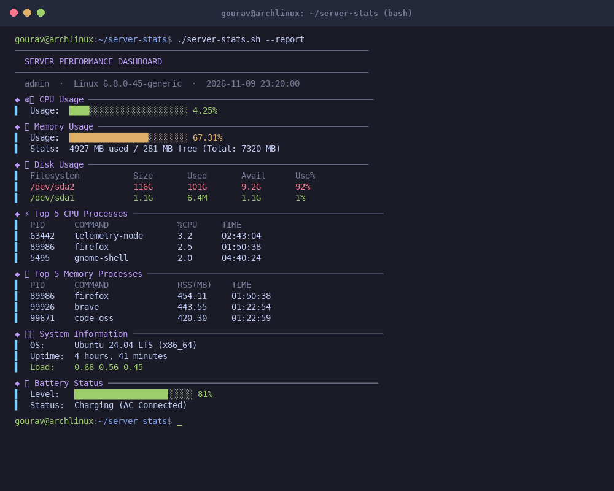

<div align="center">

```
███████╗███████╗██████╗ ██╗   ██╗███████╗██████╗     ███████╗████████╗ █████╗ ████████╗███████╗
██╔════╝██╔════╝██╔══██╗██║   ██║██╔════╝██╔══██╗    ██╔════╝╚══██╔══╝██╔══██╗╚══██╔══╝██╔════╝
███████╗█████╗  ██████╔╝██║   ██║█████╗  ██████╔╝    ███████╗   ██║   ███████║   ██║   ███████╗
╚════██║██╔══╝  ██╔══██╗╚██╗ ██╔╝██╔══╝  ██╔══██╗    ╚════██║   ██║   ██╔══██║   ██║   ╚════██║
███████║███████╗██║  ██║ ╚████╔╝ ███████╗██║  ██║    ███████║   ██║   ██║  ██║   ██║   ███████║
╚══════╝╚══════╝╚═╝  ╚═╝  ╚═══╝  ╚══════╝╚═╝  ╚═╝    ╚══════╝   ╚═╝   ╚═╝  ╚═╝   ╚═╝   ╚══════╝
```

**A zero-dependency terminal dashboard for real-time system monitoring**  
*Built for developers, sysadmins, and DevOps engineers who want answers fast.*

<br>

<p align="center">
  <a href="https://github.com/bminor/bash"></a>
  <a href="https://github.com/PowerShell/PowerShell"></a>
  <a href="https://github.com/torvalds/linux"></a>
  <a href="https://pubs.opengroup.org/onlinepubs/9699919799/"></a>
  <a href="https://github.com/koalaman/shellcheck"></a>
  <a href="LICENSE"></a>
</p>

</div>

---

## About

**Server Stats** is a lightweight, zero-dependency performance monitoring dashboard designed for developers, sysadmins, and DevOps engineers who need rapid visibility into hardware and process telemetry without running bloated background daemons.

Built around a modern **Tokyo Night / Nord** minimalist aesthetic, it features asymmetrical left-accent cards (`▌`) and dual-texture gauge bars (`█` / `░`) that instantly translate raw kernel counters into clean, readable performance metrics.

### At a Glance
- **Architecture**: Single self-contained script with zero runtime compilation or third-party package dependencies.
- **Platforms**: Native POSIX shell for Linux & macOS (`server-stats.sh`) and native WMI/CIM for Windows 10/11 (`server-stats.ps1`).
- **Telemetry Sources**: Direct `/proc/stat` and `/proc/meminfo` parsing on Linux, Darwin `vm_stat` page sizes on macOS, and CIM hardware providers on Windows.
- **Footprint**: Under 15ms execution time with 0.00% background daemon memory overhead.

---

## Why I Built This

I got tired of heavyweight telemetry agents and web-based server dashboards eating 300MB of RAM and 5% CPU just to report on idle edge servers. 

Most monitoring scripts out there either require separate Python runtimes, pull in bulky third-party dependencies, or dump unreadable raw text across your terminal. 

Server Stats gives you a clean, Tokyo Night styled terminal dashboard in under 15 milliseconds. It runs on core POSIX utilities (`awk`, `sed`, `grep`, `vmstat`, `ps`, `df`) on Linux/macOS and pure WMI/CIM on Windows with zero external dependencies and zero host pollution.

---

## Dashboard Preview

Here is the one-shot report mode (`./server-stats.sh --report`) running on an Ubuntu host:



---

## Key Features

- **Zero External Dependencies**: Runs out of the box on barebones installations using standard core utilities.
- **Cross-Platform Parity**: Full native support for Linux, macOS, and Windows with matching visual styles and metrics.
- **Tokyo Night Minimalist Aesthetic**: Uses left-accent pillar cards (`▌`) and dual-texture gauge bars (`█` / `░`) with dynamic color thresholds (Crimson ≥85%, Amber ≥60%, Green <60%).
- **Interactive TUI & One-Shot Modes**: Browse panels interactively or pass `--report` / `-s` to generate a non-interactive health snapshot for logging, MOTDs, or cron jobs.
- **Accurate Partition Accounting**: Automatically filters out temporary virtual ramdisks (`tmpfs`, `devtmpfs`) so disk percentages reflect real storage hardware.
- **Rogue / Hidden Task Hunter**: Option `-a` / `08` filters through `ps` for detached background processes lacking a controlling terminal (`?` TTY) to flag hidden miners or orphaned workers.
- **Integrated Wireless Diagnostics**: Scan nearby Wi-Fi access points and establish authenticated connections directly from the CLI via `nmcli` / `iw` (or `netsh` on Windows).

---

## Feature Matrix

| Capability | Linux / macOS (`server-stats.sh`) | Windows (`server-stats.ps1`) | Status |
| :--- | :---: | :---: | :---: |
| **CPU Load & Gauges** | `/proc/stat` & `vmstat` | `Win32_Processor` | 100% Parity |
| **Memory Allocation** | `free -b` / `vm_stat` (macOS) | `Win32_OperatingSystem` | 100% Parity |
| **Storage Usage** | `df -h` (excluding `tmpfs`) | `Win32_LogicalDisk` | 100% Parity |
| **Top 5 CPU Tasks** | `ps -eo pid,comm,%cpu` | `Get-Process` | 100% Parity |
| **Top 5 Memory Tasks** | `ps -eo pid,comm,rss` | `Get-Process` (WorkingSet) | 100% Parity |
| **System Uptime & OS** | `uname`, `uptime`, `who` | CIM OS & BootTime | 100% Parity |
| **Failed Logins** | `/var/log/btmp` (`lastb`) | Event Log (Event ID 4625) | Admin req. on Windows |
| **Battery Health** | `/sys/class/power_supply` | `Win32_Battery` | Laptops only |
| **Hidden Process Hunter** | Detached TTY `?` filter | Non-windowed service triage | 100% Parity |
| **Interactive Process Kill** | Validated PID termination | Safe `Stop-Process` prompt | 100% Parity |
| **Wi-Fi Scanner & Link** | `nmcli` / `iw` engine | `netsh wlan` parser | 100% Parity |
| **One-Shot Snapshot** | `--report` / `-s` flag | `-All` parameter | 100% Parity |

---

## Quickstart

### Linux & macOS

```bash
# 1. Clone the repository
git clone https://github.com/gouravroy27/Server-Stats.git
cd Server-Stats

# 2. Make executable
chmod +x server-stats.sh

# 3. Launch interactive dashboard
./server-stats.sh

# Or generate an immediate non-interactive report:
./server-stats.sh --report
```

*(Optional) Install system-wide to run from any directory:*
```bash
sudo cp server-stats.sh /usr/local/bin/server-stats
server-stats
```

### Windows (PowerShell & Batch Launcher)

Open PowerShell or Command Prompt:

```batch
:: 1. Clone the repository
git clone https://github.com/gouravroy27/Server-Stats.git
cd Server-Stats

:: 2. Launch via batch wrapper (automatically bypasses execution policy)
.\server-stats.bat
```

Or run directly via PowerShell:
```powershell
Set-ExecutionPolicy -Scope Process -ExecutionPolicy Bypass
.\server-stats.ps1
```

---

## CLI Options & Usage

```
Usage: ./server-stats.sh [OPTIONS]

  -s, --report             Print full non-interactive performance snapshot and exit
  --about                  Display project information, version, and author details
  -a, --all                Show hidden / detached background processes
  --kill <PID>             Interactively verify and terminate a rogue PID
  --wifi-list              Scan and list nearby Wi-Fi networks
  --wifi-current           Display active wireless link quality and SSID
  --wifi-connect <SSID>    Connect to an access point (prompts for passphrase)
  -h, --help               Display usage information
```

### Interactive Menu Keybindings

When running in interactive mode, use the following options:

| Key | Section | Description |
|:---:|:---|:---|
| `01` | **CPU Metrics** | Real-time user/system utilization calculated via `/proc/stat` & `vmstat` |
| `02` | **Memory Stats** | Exact byte parsing via `free -b` or macOS `vm_stat` page sizes |
| `03` | **Disk Usage** | Mounted partition utilization with temporary ramdisks excluded |
| `04` | **Top CPU Tasks** | Top 5 processes consuming active CPU cycles |
| `05` | **Top Memory Tasks** | Top 5 processes consuming physical resident memory (RSS) |
| `06` | **System Info** | Kernel release, uptime, load averages, and active users |
| `07` | **Battery Status** | Power draw and charge level via `/sys/class/power_supply/` |
| `08` | **Hidden Processes**| Detached background tasks without a controlling terminal |
| `09` | **Wi-Fi Scanner** | Nearby wireless network discovery with RSSI and encryption flags |
| `10` | **Wi-Fi Current** | Current connected SSID and link parameters |
| `11` | **Full Report** | Sequentially render all diagnostic cards in a single pass |
| `12` | **About** | Display project metadata, version, and repository links |
| `r`  | **Refresh** | Redraw the current screen |
| `0`  | **Exit** | Cleanly return to shell |

---

## Requirements

Server Stats relies purely on core operating system binaries:

### Linux / macOS
- **Shell**: Bash 4.0 or newer (`bash --version`)
- **Core Utilities**: `awk`, `sed`, `grep`, `ps`, `df`, `vmstat`, `uptime`, `hostname`
- **Memory Metric**: `free` (Linux) or `vm_stat` (macOS)
- **Wi-Fi (Optional)**: `nmcli` (NetworkManager) or `iw`

### Windows
- **Operating System**: Windows 10 (Build 1809+) or Windows 11
- **Runtime**: PowerShell 5.1+ or PowerShell Core 7+ (recommended via Windows Terminal)
- **Services**: WLAN AutoConfig service (for wireless scanning)

---

## Project Structure

```
.
├── server-stats.sh       # POSIX-compliant dashboard for Linux & macOS
├── server-stats.ps1      # Native WMI/CIM dashboard for Windows
├── server-stats.bat      # Windows batch launcher (bypasses execution policy)
├── requirements.txt      # System prerequisites and package installation notes
├── LICENSE               # MIT License
└── docs/
    └── dashboard_preview.png  # High-DPI terminal screenshot
```

---

## License

This project is released under the [MIT License](LICENSE). Feel free to use, modify, and distribute it across your systems.
